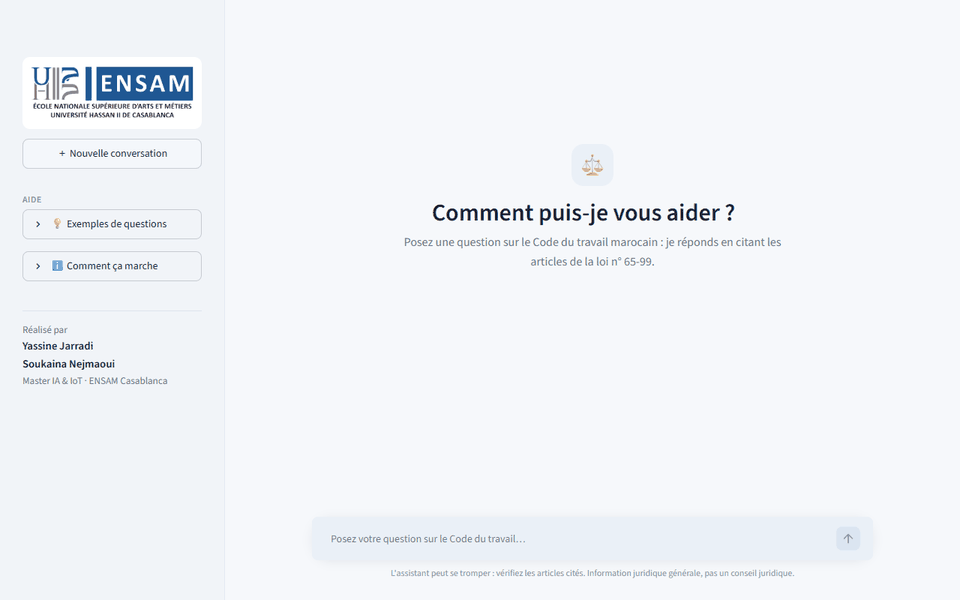
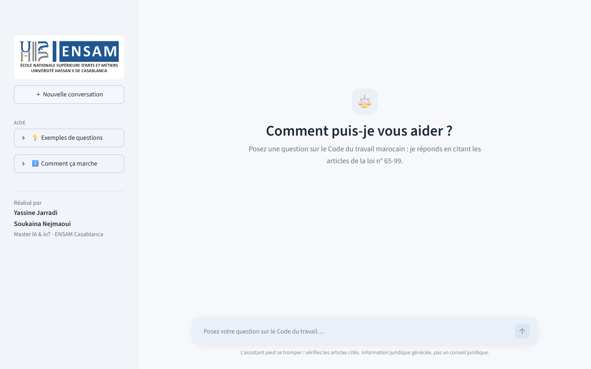
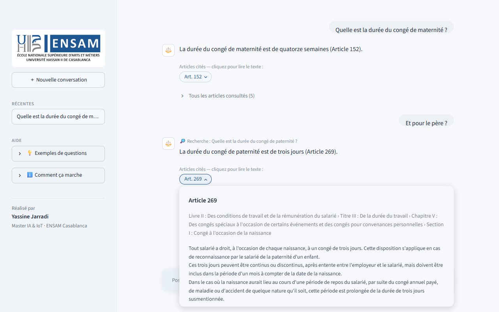
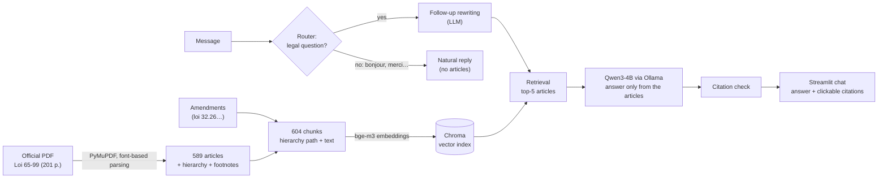

# ⚖️ Assistant Code du Travail — RAG chatbot for Moroccan labour law

[](https://github.com/Yassinejarradi/assistant-code-du-travail/actions/workflows/tests.yml)

**Yassine Jarradi** · **Soukaina Nejmaoui** — Master IA & IoT, ENSAM Casablanca

A chatbot that answers questions about the **Moroccan Labour Code (Loi n° 65-99)** in plain French and
**cites the exact articles** it relies on. It runs **100 % locally and for free** on a laptop: open-source
embedding model, local vector database and a local LLM, with no API and no data leaving the machine.



## Features

- **Answers grounded in the law.** The LLM only sees the 5 most relevant articles and must cite them
  as « (Article N) ». When the Code doesn't cover a question, it says so instead of inventing an answer.
- **Clickable citations.** Each cited article opens its full text and its place in the Code
  (Livre › Titre › Chapitre › Section).
- **Follow-up questions.** « Et pour le père ? » after a question on maternity leave is rewritten into
  « Quelle est la durée du congé de paternité ? » before searching.
- **Citation check.** Every article cited in an answer is verified against the sources given to the
  model, and anything else is flagged as possibly invented.
- **Kept up to date.** Amendments published after the 2011 text are attached to their article, for
  example **loi n° 32.26 (2026)**: private security agents now work 8 h/day instead of 12 (art. 193).
- **Natural conversation.** Greetings, thanks and off-topic messages get a short, human reply without
  searching the law; articles only appear when an answer relies on them. A router (rules for obvious
  cases, the LLM for the rest) decides whether a message is a legal question.
- **Chat interface** in the style of ChatGPT: conversation history, streamed answers, sources panel.

| Home | Answer with an opened citation |
|---|---|
|  |  |

## How it works



| Step | Choice | Why |
|---|---|---|
| Extraction | PyMuPDF, using font size, bold and superscript flags | The PDF's typography encodes the structure (Livre 18pt, Chapitre 16pt, article headings, footnote markers). Validated: articles 1–589 continuous, none empty. |
| Chunking | 1 article = 1 chunk; long articles split at paragraphs, repeating their lead-in | The article is the citation unit; 95 % of articles are under ~270 tokens. |
| Embeddings | `BAAI/bge-m3` (multilingual) | Understands everyday wording ("enceinte" ↔ "état de grossesse", "SMIG" ↔ "salaire minimum légal"). |
| Retrieval | Dense search + direct lookup for "article N"; BM25 hybrid tested | Measured below: hybrid search did **not** beat dense search on this data. |
| Generation | `qwen3:4b-instruct` via Ollama, temperature 0.1 | Fits a 4 GB GPU; the instruct variant avoids slow hidden reasoning. |

## Results

Retrieval measured on 50 test questions in four styles (formal, colloquial, everyday vocabulary
absent from the law, direct article reference). Recall@k is the share of questions whose correct
article is in the top k results.

| Method | Recall@1 | Recall@5 | MRR |
|---|---|---|---|
| BM25 (keywords) | 0.42 | 0.64 | 0.52 |
| **bge-m3 (dense, used)** | **0.74** | **0.92** | **0.81** |
| Hybrid BM25 + dense, equal weights (RRF) | 0.58 | 0.78 | 0.67 |
| Hybrid, BM25 weight 0.1 | 0.74 | 0.90 | 0.81 |

Last measured on 23 October 2026 on the current index (including the art. 193 amendment), with
`python src/evaluate_retrieval.py`. Every BM25 weight above 0 lowered recall, so dense search is the
default.

On colloquial questions, dense search reaches 0.83 Recall@5 against 0.50 for BM25, and on everyday
vocabulary 1.00 against 0.33. Details, experiments and lessons learned are in
[docs/02_retrieval.md](docs/02_retrieval.md).

Speed on the development laptop (i7-8750H, 16 GB RAM, GTX 1050 Ti 4 GB): about **1 min** to load
the models once when the page opens, then **~5–15 s per answer**.

## Quick start

**Requirements:** Python 3.11+, [Ollama](https://ollama.com), about 6 GB of free RAM and 6 GB of disk.

```bash
python -m venv .venv
.venv\Scripts\activate                      # macOS / Linux: source .venv/bin/activate
pip install torch --index-url https://download.pytorch.org/whl/cpu
pip install -r requirements.txt
ollama pull qwen3:4b-instruct

python src/build_index.py                   # builds the vector index once (~10 min on CPU)
streamlit run app.py                        # opens http://localhost:8501
```

On Windows, after the first setup, double-click **`lancer_assistant.bat`**: it starts Ollama if
needed, launches the app and opens the browser. Close heavy apps (games, many browser tabs) first.
With too little free RAM, Windows swaps to disk and answers become very slow.

## Full pipeline

```bash
python src/extract_articles.py      # PDF -> data/articles.json (589 articles)
python src/validate_articles.py     # checks continuity, empty articles; prints stats
python src/chunking.py              # -> data/chunks.json (604 chunks, amendments merged)
python src/build_index.py           # bge-m3 -> Chroma; --update re-embeds only changed chunks
python src/evaluate_retrieval.py    # Recall@k / MRR on data/eval/questions.json
python src/retriever.py "question"  # top-5 articles, no LLM
python src/rag.py "question"        # full answer in the terminal
streamlit run app.py                # web interface
```

## Tests

```bash
python -m pytest        # 42 tests, ~1 s, no model or Ollama needed
```

They check the data (589 continuous articles, chunks, amendments, evaluation set), citation parsing,
the small-talk / legal routing rules, the French tokenizer and the chunking rules. GitHub Actions
runs them on every push.

## Adding an amendment

The source PDF is the 2011 consolidated version. Later changes go in `data/amendments.json`
(article, amending law, Bulletin Officiel reference, summary or official text, sources). They are
attached to the article as a labelled note, so the chatbot cites both the article and the law.

```bash
python src/chunking.py
python src/build_index.py --update  # seconds instead of a 10-minute rebuild
```

Included: **loi n° 32.26** (B.O. n° 7526, 16 July 2026) → art. 193. Only a summary from press
sources is stored; the official wording should replace it once taken from the Bulletin Officiel.

## Known limitations

- **Small local model (4B).** It occasionally picks the wrong article among correct sources, or
  contradicts itself on subtle provisions (e.g. art. 193, point 2, for concierges). Larger models
  are better but too slow on a 4 GB GPU.
- **Test set.** The 50 evaluation questions and their expected articles were drafted with an AI
  assistant; an independent review is in progress.
- **Law version.** 2011 consolidation plus the amendments listed in `data/amendments.json`.
- **French only** for now. Arabic support (Arabic text of the Code, strike law 97-15) is planned.
- General legal information, **not legal advice**.

## Project structure

```
├── app.py                             # Streamlit chat interface
├── lancer_assistant.bat               # one-click launcher (Windows)
├── src/
│   ├── extract_articles.py            # PDF -> structured articles
│   ├── validate_articles.py           # data checks + stats
│   ├── chunking.py                    # articles (+ amendments) -> chunks
│   ├── build_index.py                 # embeddings -> Chroma (full or incremental)
│   ├── retriever.py                   # lookup + dense (+ BM25) + RRF
│   ├── text_utils.py                  # French tokenizer for BM25
│   ├── evaluate_retrieval.py          # Recall@k / MRR
│   └── rag.py                         # follow-up rewriting, prompt, LLM, citation check
├── tests/                             # pytest suite (runs on GitHub Actions)
├── data/
│   ├── raw/code_du_travail_2011.pdf   # official source (adala.justice.gov.ma)
│   ├── articles.json                  # 589 extracted articles (never hand-edited)
│   ├── amendments.json                # post-2011 amendments
│   ├── chunks.json                    # retrieval units
│   ├── eval/questions.json            # retrieval test set
│   └── index/                         # vector index (generated, not in git)
├── docs/
│   ├── 02_retrieval.md                # retrieval design, experiments, results
│   └── images/                        # README screenshots and demo
├── assets/ensam_logo.png
└── .streamlit/config.toml             # local-only server, theme
```

<details>
<summary><b>Data format and extraction details</b></summary>

### `data/articles.json`

One record per article:

| Field | Description |
|---|---|
| `id` | `code-travail-art-<n>` |
| `article_number` | int, 1–589 (*Article premier* → 1) |
| `livre`, `titre`, `chapitre`, `section`, `sous_section` | Full heading, `null` when the level doesn't exist |
| `text` | Article body; paragraphs and list items on separate lines |
| `abrogated` | `true` for repealed articles (only art. 256), with `text = "[Abrogé]"` |
| `notes` | Footnotes: implementing decrees, repeals, cross-references |
| `page`, `source`, `version_date` | Provenance (`version_date = "2011-10-26"`) |

### Extraction

The extractor relies on PyMuPDF's span-level font information, because the PDF's typography
encodes the structure:

| Element | Style in the PDF | Handling |
|---|---|---|
| Body | Book Antiqua 14pt | kept |
| Article heading | `Article N`, bold 15pt (art. 156 and 458 are not bold) | regex + must follow the previous number |
| Livre / Titre / Chapitre / Section | bold 18 / 16 / 16 / 14pt | hierarchy; wrapped headings joined; `Il` → `II` |
| Footnote markers | superscript spans | removed from the text, recorded in `notes` |
| Footnotes | Times 12pt, bottom of the page | collected by number (1–102 across the document) |
| Page numbers, front matter | — | dropped |

Source quirks kept as is: art. 278 has an item numbered `5.` that is a closing sentence, and some
headings have inconsistent capitalisation.

</details>

## Source and disclaimer

Official French consolidated version of 26 October 2011, published by the Ministry of Justice on
[adala.justice.gov.ma](https://adala.justice.gov.ma). This project provides general legal
information and is not a substitute for advice from a lawyer or the labour inspectorate.
